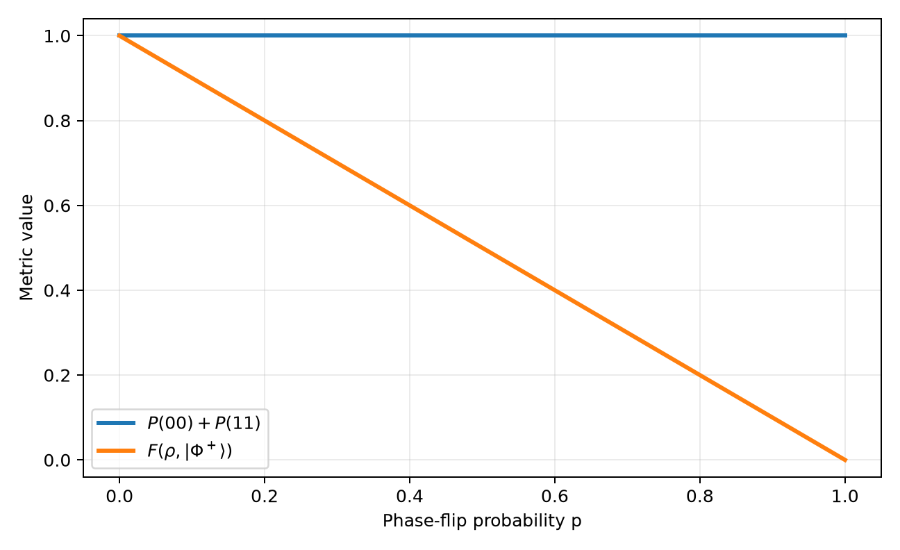

# Q-Reliability Lab

[](https://github.com/Raina-ya/q-reliability-lab/actions/workflows/ci.yml)

Can a Bell-state circuit receive a perfect score after a phase error has changed the state?

This repository studies one narrow reliability problem. A phase-flip channel is applied to the first qubit of

$$
|\Phi^+\rangle=\frac{|00\rangle+|11\rangle}{\sqrt{2}},
$$

and five quantities are compared over 101 values of the phase-flip probability. The computational-basis success probability remains equal to one, while the X-basis diagnostic, fidelity, and signed coherence reveal that the target state has been lost.

This is an AI-assisted research artifact whose derivations, source code, tests, generated data, and limitations are exposed for review. It is a deterministic classical simulation, not quantum-hardware data.

## Result

For

$$
\mathcal{E}_p(\rho)=(1-p)\rho+p(Z\otimes I)\rho(Z\otimes I),
$$

the simulated metrics agree with

$$
S(p)=P(00)+P(11)=1,
\qquad
S_X(p)=P(++)+P(--)=1-p,
\qquad
F(p)=1-p,
\qquad
\mathrm{Re}(\rho_{00,11})=\frac{1-2p}{2}.
$$

The X-basis correlated-success diagnostic is evaluated with the projector
$\Pi_X=|++\rangle\langle++|+|--\rangle\langle--|$, rather than by hardcoding
the analytic relation. It falls from one to zero under phase flips, whereas
the computational-basis metric $S(p)$ remains one.



The complete derivation, numerical table, limitations, and references are in the [report](paper/main.pdf). The [research log](notes/2026-10-22-metric-blind-spot.md) preserves the hypothesis written before the sweep and records the result afterward.

## Repository contents

- `paper/main.tex` and `paper/references.bib`: Overleaf-compatible report source.
- `paper/figures/`: figures generated by the experiment code.
- `paper/main.pdf`: compiled report.
- `src/phase_error_blind_spot.py`: density-matrix simulation and artifact generation.
- `tests/`: analytic, physical-invariant, X-basis, and generated-data regression tests.
- `experiments/phase_error_sweep.csv`: complete 101-point sweep.
- `notes/`: research question, pre-execution hypothesis, result, and interpretation boundary.

## Reproduce the experiment

Python 3.10 or newer is required.

```powershell
py -3 -m venv .venv
.\.venv\Scripts\python.exe -m pip install -e ".[test]"
.\.venv\Scripts\python.exe -m pytest
.\.venv\Scripts\python.exe -m src.phase_error_blind_spot `
  --output experiments/phase_error_sweep.csv `
  --figures paper/figures `
  --table paper/generated/phase_error_results_table.tex
```

The final command deterministically regenerates the CSV, the three figures,
and the paper's representative-results table. No Monte Carlo sampling is used
in this phase-error sweep. GitHub Actions repeats the test suite, artifact
generation, and paper compilation in a clean environment.

## Finite-shot sampling

Finite-shot estimates are explicitly labeled as observed and are separate from
the analytic probabilities:

```python
from src.finite_shot_phase_error import sample_success_counts

result = sample_success_counts(probability=0.3, basis="X", shots=1_000, seed=20261030)
print(result.observed_success_probability, result.analytic_success_probability)
```

For this model, Z-basis correlated success is always one, whereas X-basis
correlated success has analytic probability `1 - p` and is sampled with the
given seed.

Regenerate the pre-registered 3,000-row finite-shot sweep with:

```powershell
.\.venv\Scripts\python.exe -m src.finite_shot_phase_error `
  --output experiments/finite_shot_sweep.csv `
  --root-seed 20261030
```

Generate the finite-shot detectability figure from that CSV with:

```powershell
.\.venv\Scripts\python.exe -m src.finite_shot_figures `
  --input experiments/finite_shot_sweep.csv `
  --output paper/figures/finite_shot_detectability.png
```

## Compile the report

Upload the repository to Overleaf and select `paper/main.tex` as the main document, or compile locally from the `paper` directory:

```powershell
cd paper
pdflatex main.tex
bibtex main
pdflatex main.tex
pdflatex main.tex
```

## Scope and limitations

- The phase-flip channel is a simplified analytic model.
- SPAM error, crosstalk, coherent calibration error, finite-shot uncertainty, and drift are not included.
- The noise is applied after ideal Bell-state preparation, not at a specified location inside a physical CNOT implementation.
- No claim is made about the CNOT error rate of IBM hardware or any other real device.
- Fidelity to one target and coherence magnitude are also incomplete metrics; the report states what each quantity can and cannot detect.

## License

MIT
